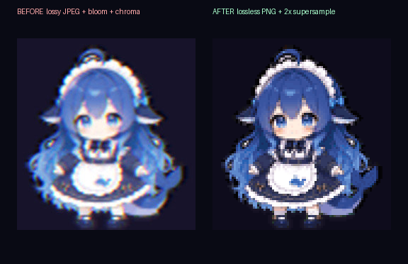

# 修复前后对照与变更报告（2026-11-24）

> 范围：这一历史轮只修交付链、资产链、可复现 QA 与文档矛盾，**当时没有新增生图，没有替换或重画任何角色立绘 / 图集**；当时的母版 SHA256 是 `5f9894b6ad38c26a62ec55a030aeb49bce8360c3d67ef99d1f581430d7ec81da`。没有 commit / push / PR。
>
> 本文只记录这一历史轮。同一天后续任务中用户另行明确授权本鲸 V2 重画 / `master_soft` / 手臂修复 / 饭碗修复 / 6.5 秒短片对照；随后又明确撤销「把下半身一直定着」的做法，要求保留重画前旧版围裙 / 裙摆 / 靴子、修复发抖 / 摇摆舞 / 吃惊等头身分离、并重做走路节奏。最后又按用户指令把挥手打招呼 / 递出去（让位）回退到「加裙子固定之前」的状态；当前母版是 2048×3126 / 682 格、SHA256 `16681c7b253e194556e97043e44b83069c05ed9ea1eb9eaf8ffaa4d832535793`（此后再按用户指令把 8 帧走路回退到重画前），前后对照见 [`whale_redraw/whale_redraw_report.md`](whale_redraw/whale_redraw_report.md)。本文里的旧母版哈希是重画前的基线。

## 一眼看结果



对照图取自母版真实格子 `act_whale_idle_0`（`[1118,2055,84,90]`），放大 3 倍。左边按旧链模拟：平滑放大 → bloom → 色差 → JPEG Q92 → JPEG Q85；右边按新链：2× 最近邻超采样 → 盒式降采样 → 无 bloom / 色差 → lossless PNG。这不是新画的角色，只是把同一像素源走两条交付链后的结果并排。

| 指标 | 修复前 | 修复后 | 变化 |
| --- | ---: | ---: | ---: |
| PSNR（相对 lossless 参考） | 18.16 dB | 65.88 dB | +47.71 dB |
| 边缘能量 | 6.85 | 22.16 | +15.31 |
| 逐帧中间格式 | JPEG Q0.92–0.95 | PNG（JPEG 仅 Q95 兜底） | 去掉生成损失 |
| H.264 默认 | CRF 20/21，3200–3500k | CRF 16，12000k，AAC 192k | 提高母版余量 |
| 像素贴图过滤 | linear，`alphaTest 0.06` | nearest + 本鲸 `master_soft` 1px 覆盖边 | 保住像素块，略减锯齿 |

指标文件：`comparison.json`。运动 QA 用母版现有八帧 `walk_whale_*` 生成 24 帧确定性序列，结果 `motion_qa.json`：无空帧、无冻帧、平均帧差 2.212；缩略图 `motion_contact_sheet.png`。以上数值是 2026-11-24 本鲸 V2 `master_soft` 母版后按当前图集重跑 `npm run qa:visual` 的值，和 V1、旧图集的历史数值不同；前后像素对照另见 `whale_redraw/`。**这只能证明扫描器工作，不等于整片好看。**

## 最高影响修复（按评审建议的顺序）

| 顺序 | 评审项 | 落地内容 |
| --- | --- | --- |
| #1 | 画质 / 编码 | `tools/render_defaults.json` 统一 PNG、CRF16、12000k、bloom×0.45、阈值 0.95、色差 / 颗粒归零、2× 超采样、nearest；五支 `tools/shoot_*.mjs` 与 `tools/encode_frames.py` 读同一份默认值；12 处运行时 `toDataURL('image/jpeg', …)` 改 PNG；情歌两版和樱花 / 棒棒糖引擎同步降 bloom / 去颗粒 / 改过滤。 |
| #2 | 生成素材溯源 | `人物/生成/满月篇/assets.manifest.json`、`tools/generated_assets/process_generated.cjs`、`tools/generated_assets/validate_generated.py`、`docs/quality_comparison/generated_asset_report.json`：11 个历史素材、22 份副本逐项核对硬边 alpha、透明四角和 SHA256；两份月亮工程的 `tools/process_generated.cjs` 收成薄适配器，输出改到实际被引用的 `src/assets/gen/`，并各自写入 `src/assets/gen/manifest.json`；`npm run generated:postcheck` 用同一套后处理在内存中重算 11 个派生图、只比对哈希，不覆盖现有角色图。模型 / 版本 / seed 当年未记录，保留 `legacy_unknown` 警告，不伪装成可复现生图。 |
| #4 | 哈希源真相 | `assets.manifest.json` + `tools/check_asset_hashes.mjs`：42 个文件记录 SHA256 / 字节数 / 镜像关系；母版与九份镜像逐字节一致，opus 重排图集单独登记，立绘 / 字体 / 音轨副本也纳入检查。 |
| #3 | 骨架 / 动作 | `通用模板/engine/assets/tachie_anchors.json` 成为八位立绘尺寸、neck/cx/hx/base 的唯一来源；`人物/立绘/src/mv/layers.ts` 显式 `layerStatus: single-layer` 并 fail-fast；`actions.ts` 增加纯函数 `blendPose` / `poseOfBlend`；模板 `tachie.ts` 增加 `actFrame(action, f)` 与 `blend()`，样例镜头改用整套 `Frame` 时间。没有捏造不存在的眼睛 / 嘴 / 手图层。 |
| #5 | 修复 `人物/立绘` | `tools/copy_standing_assets.mjs` 把现有 `art/tachie/*.png` 逐字节镜像到 `public/tachie/*.png`，补齐字体和音轨；`cast.ts` / `assets.ts` 统一 `.png` 并允许缺背景；`key-tachie.mjs` 改用仓库已有的 `pngjs` 默认检查锚点与透明四角，根脚本 `npm run standing:check` 把它接进 QA，`--write` 只刷新 `art/tachie/metrics.json`；`render-actions.mjs` 去掉全局 `T += 1/30`，改为纯函数逐帧，输出 `/tmp/tachie_preview/`；`package.json` 声明依赖与脚本，`next-env.d.ts` 补齐。 |
| #6 | 确定性逐帧 | `tools/capture_contract.md` 定义 `window.__FILM__`；`tools/capture_quality.mjs` / `tools/shoot_film_adapter.mjs` 冻结 rAF、逐帧 `render(t)`、stage-only PNG 截图；`人物/立绘/src/components/MvPlayer.tsx` 暴露 `__FILM__.render(t)`；旧 `__mv.render` / `__mvRender` / `__seek` 仍兼容。 |

同一轮还补齐了 #7 视觉 / 运动 QA、#8 通用步态溢色检查、#9 立绘逐帧时钟、#10 文档 / 旧脚本矛盾、#11 依赖 / CI：新增 `tools/visual_motion_qa.py`、`通用模板/cast/check_walk_frames.mjs`、`requirements.txt`、`.github/workflows/ci.yml`、`tsconfig.quality.json`；`tools/split_cast.py` 与两版素材还原脚本默认 check-only，不再误删派生目录或为已删工程重建目录；`fix_whale_walk_bleed.mjs` 标注为一次性历史补丁。

## 机器检查

```bash
npm ci
python3 -m pip install -r requirements.txt
# 或本机 PEP 668：python3 -m venv .venv && .venv/bin/pip install -r requirements.txt
npm run qa:all
npm run generated:postcheck
npm run capture:film -- --dist <构建目录> --out /tmp/frames --dur 30 --format png
npm run qa:motion -- --frames /tmp/frames      # 拿到真实渲染帧后再跑
python3 tools/encode_frames.py --frames /tmp/frames --audio <音轨> --out /tmp/enc.mp4
```

`npm run qa:all` 串起模板单测、共享源码类型检查、图集重建、本鲸重画专项检查、步态溢色、资产哈希、生成素材校验、确定性后处理检查和画质 / 运动对照。

本鲸 V2 修复后再次实际执行 `npm run qa:all` 通过：52 个 JS 测试 + 13 个 Python 测试、`tsconfig.quality.json` typecheck、图集 682 格哈希一致、`WHALE_REDRAW_OK 111 frames · 13 actions · 92 derived frames · 9 mirrors`、58 个步态格无边缘碎片、8 张立绘锚点 / 透明底检查通过、42 个资产哈希一致、11 个历史素材 / 22 份副本校验通过、两份月亮工程各 11 个派生图后处理哈希一致、画质与运动 QA 24 帧无空帧 / 冻帧（平均帧差 2.212）。唯一警告是 `legacy_unknown`：历史生图模型 / 版本 / seed 不可考。CLI 入口：`npm run generated:postcheck`、`npm run qa:visual`、`npm run whale:qa`。

另做了两条端到端冒烟（产物只在 `/tmp`，未入库）：`tools/shoot_film_adapter.mjs` 对一个最小 `window.__FILM__` 页面逐帧输出 2 张 PNG；`tools/encode_frames.py` 把 3 张 PNG 编成 MP4；`npm run qa:motion -- --frames /tmp/film_frames --out /tmp/qa_motion` 对真实帧序列扫描通过（平均帧差 15.63，无空帧 / 冻帧）。本鲸 V2 另按用户授权用同一捕获链输出 6.5 秒 / 78 帧无声短片：`docs/quality_comparison/whale_redraw/film_compare.mp4`、`film_compare_contact.png` 与 `film_compare_frames/`；这是短片对照，不是整片或音频复核。

`tsconfig.quality.json` 只覆盖共享引擎、预览、样例和本次改过的质量关键文件；仓库里各历史 MV 子工程依赖不同、缺独立 lockfile，仍需各自安装依赖后单独 typecheck，不能拿一个根配置假装全覆盖。

## 边界与未做的事

- 对照图是**确定性模拟**，不是把旧成片重新解码出来的逐帧 A/B；母版角色分辨率没有提高，90×90 像素源的信息量不会凭空变多。要真正更多细节只能另做高分辨率母版，那属于新增美术，本次明确不做。
- 这一历史轮没有新增生成图片、没有替换角色立绘、没有重烘图集；`docs/quality_comparison/*.png` 当时是由现有图集格子算出的 QA 文档，不是新角色资产。后续本鲸 V2 是用户另行明确授权的一次性例外，详见 `whale_redraw/whale_redraw_report.md`。
- `generated_asset_report.json` 的 `legacy_unknown` 是事实，不是待办：历史生图模型 / seed 不可考，只能锁定已有文件与后处理链。
- 没有人从头到尾看过整片、听过音画同步；签收状态见 `human_sign_off.md`。机器检查通过 ≠ 片子好看。
- 新 CRF16 / 12000k 母版可能比旧 CRF21 / 3200k 更大；若受 GitHub 单文件 100 MB 限制，应显式给 `tools/encode_frames.py` 传 `--crf` / `--maxrate`，不要偷偷改回 JPEG。
- 本轮没有 commit、push、建分支或开 PR；工作区变更留在当前分支供审阅。

详细路径、脚本和默认值索引见 `README.md`、`tools/capture_contract.md`、`tools/render_defaults.json`。
