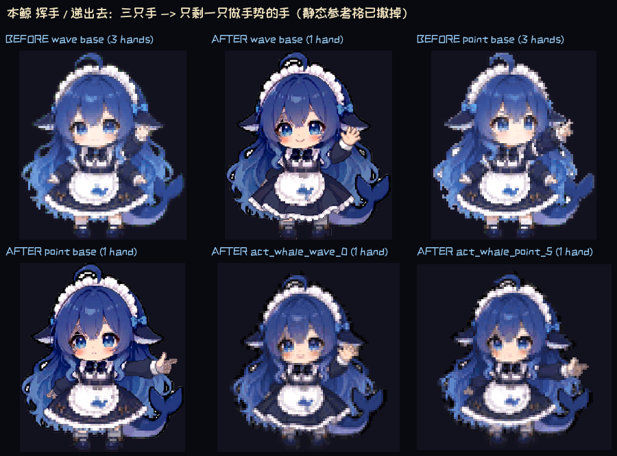
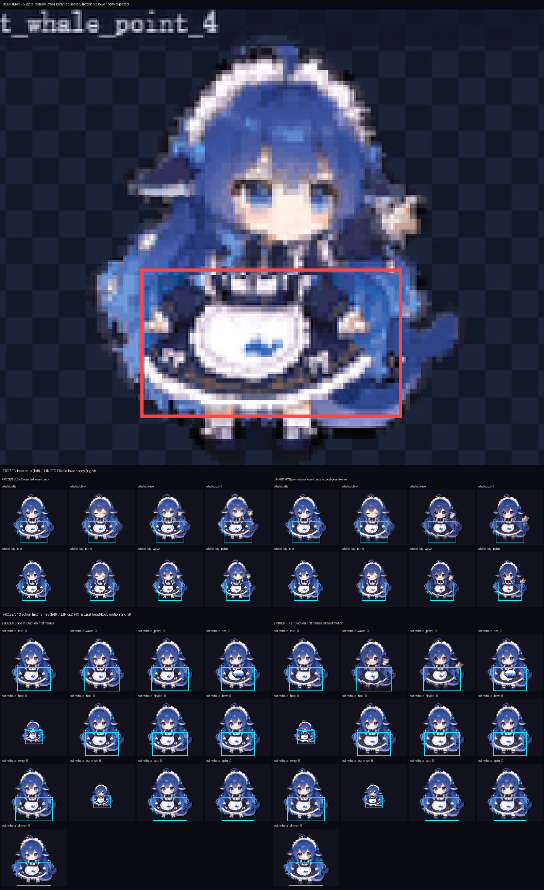
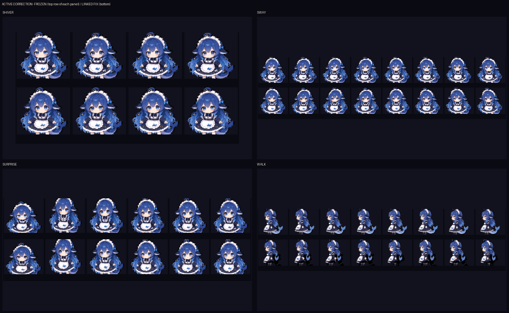
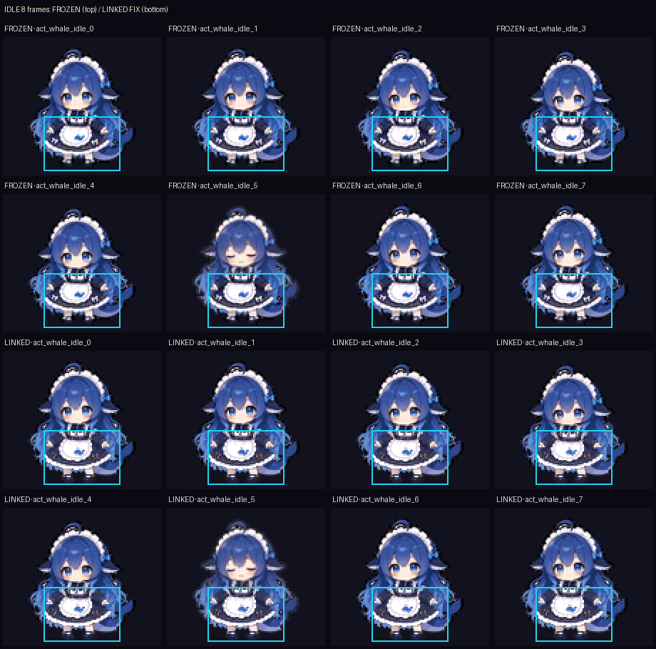
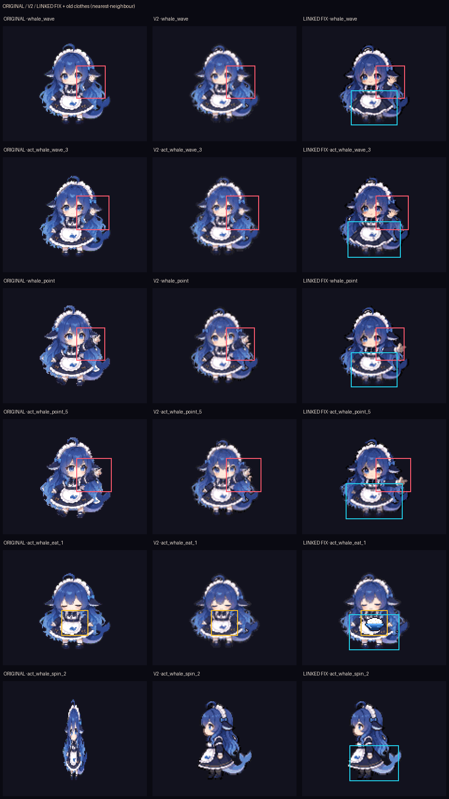
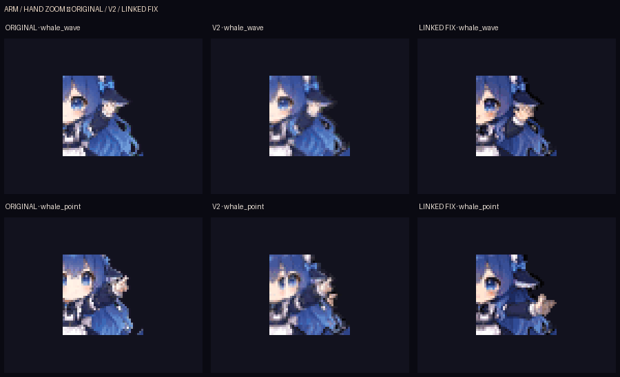
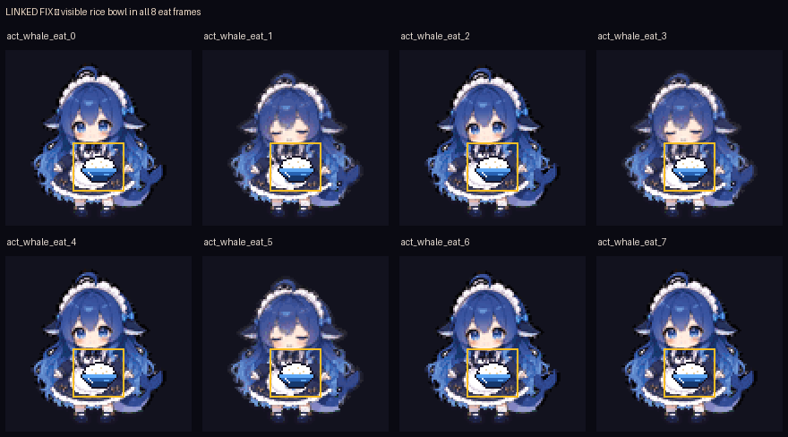
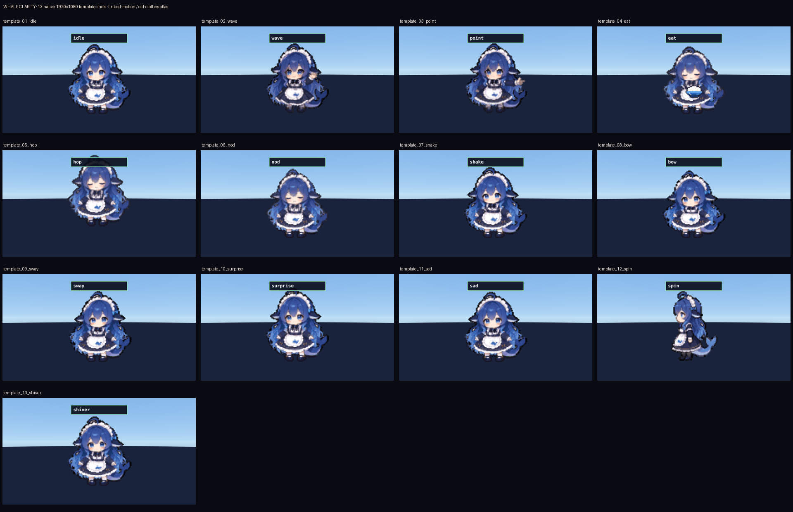
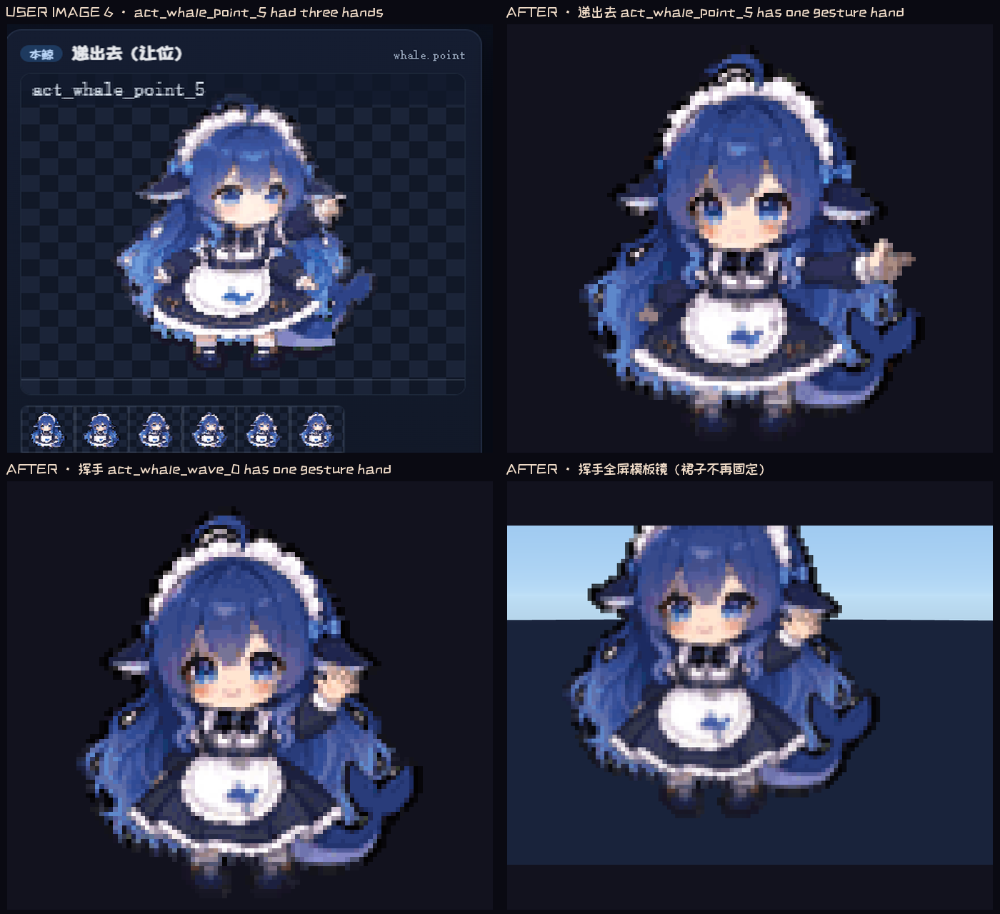
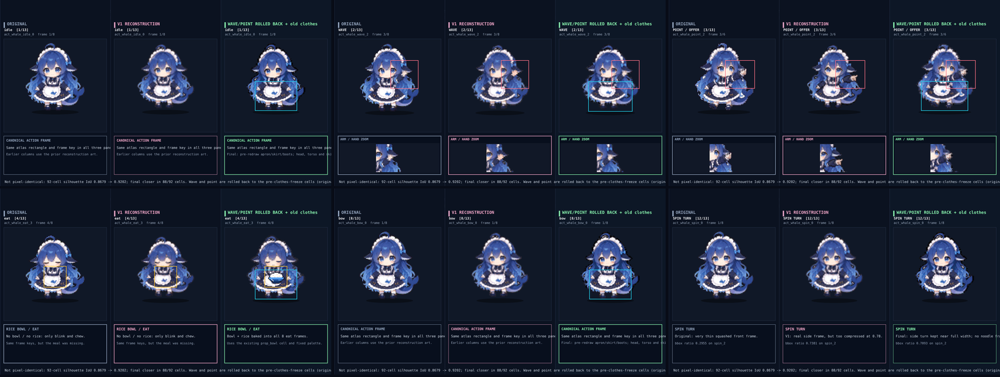

# 本鲸旧下半身 / 头身联动 / 走路节奏修正报告（2026-11-24）

> 当前分支 `arena/e3350838-latest-aiyunying`，HEAD `7217fde`。用户先授权 `full_redraw` / `all_actions` / `sync_all`，随后选择 `master_soft` / `regen_closer` / `spin_point` / `short_film`，并先后纠正「挥手手还是断的请修复」「你看看你这对吗，还有干饭的饭呢，然后渲染整个到模板里看看清晰度」「为什么这几个动作的衣服一直在变请修复下」。之后用户用 `image-5.png` 撤销了上一版「一直定着」的 `5b0e…` 做法，并经 `ask_user` 明确选择 `old_lower_body` / `unlock_all` / `fix_linkage_only` / `fix_rhythm`。随后再次 `ask_user`，用户选择 **`f23`——回退到「加裙子固定之前」**：只把 `wave`（挥手打招呼）与 `point`（递出去/让位）两个动作回退，其他 11 个动作保持不变。本报告记录**当前实际入库的最终状态**；V2 阶段报告保留在 `whale_redraw_report_v2.md`，已标为历史文档。没有 commit / push / PR，没有换分支；整片从头到尾观看、音频复核与人工签收仍不在授权内，`human_sign_off.md` 仍是 **NOT SIGNED**。

## 直接回答这次纠正

**你说得对，上一版把下半身「定住」不是正确修复。** `image-5.png` 是 `act_whale_point_4` 的裁切，红框里仍是上一轮 V2 下半身；更关键的是 `5b0e…` 用 `freezeWhaleClothes()` 在 `pose()` 之后把 84 张正面动作下半身盖成同一块像素，导致发抖 / 摇摆舞 / 吃惊等动作出现头在动、肩颈以下不动，走路也变成整张图滑动、手臂 / 双腿 / 鱼尾节奏被改坏。

这一轮按四项选择重做：

- `old_lower_body`：以 `cast_atlas.before.png` 的重画前下半身为来源，统一四张正面 clean 稿的 `[0.18,0.58,0.82,1.0]` 区域；不是把动作里的下半身逐帧锁死。
- `unlock_all`：删除 `freezeWhaleClothes()` / `fit_with_front_clothes()`，让 `pose()` 自然带动头、肩、躯干、裙摆、腿；脚底仍锚定。
- `fix_linkage_only`：只修既有动作的联动，不新增喜怒哀乐动作、头像或帧位；`cast_atlas.json` 的 682 个矩形坐标不变，也没有 `--repack`。
- `fix_rhythm`：保留当前蓝发侧脸造型，重做 8 帧侧视走路的手臂 / 双腿 / 鱼尾节奏；不逐像素回退旧步态，也不新生成一套走路图。









## 实现与本鲸专属边界

1. **旧下半身基础稿**：`whale_redraw_refs/fix_whale_clothes.py` 用仓库根 `parents[4]` 读取 `cast_atlas.before.png` 与 `cast_atlas.json`，把旧版围裙 / 裙摆 / 靴子贴到 `whale_{front,blink,wave,point}_clean.png` 的下半身。`encode_whale_sprites.py` 的 `fit_with_old_clothes()` 在 fit 到原坐标尺寸后再次精确贴回旧图集补丁，避免重采样把旧像素糊掉。2026-11-24 **最终回滚**：`wave` / `point` 的 clean 稿已换回重画前的参考格（`whale_{wave,point}_ref.png` 的副本），因此这两个动作重新带「原始手臂姿势 + 自己的裙摆」，也**不再贴旧下半身补丁**——它们不是 `idle` / `blink` 那条旧围裙路径。`fix_whale_clothes.py` 的 `TARGETS` 回到 `('front','blink')`，`hide_extra_hands.py` 与 `fit_with_old_clothes` 都不再作用于这两张稿。代价如实说明：这两个动作的原始参考格本身就有第三只手，回滚即把它带回来，这是用户「回退到加裙子固定之前」的直接结果，不再当成缺陷去修。历史备份 `whale_{wave,point}_v2_fixed_clean.png`、`whale_{wave,point}_static_hand_before.png` 与 `restore_original_pose_refs.py` 仅留档。
2. **自然联动**：`bake_actions.mjs` 已移除 `freezeWhaleClothes()`，新增本鲸专属 `WHALE_MOTION` / `WHALE_LINK` 与 `pf` 系数；回滚后 `WHALE_MOTION.wave` 恢复为「正面格 + 7 帧手势格」、`point` 为「正面格、正面 lean 0.03 + 4 帧手势格」，`WHALE_LINK.wave` / `WHALE_LINK.point` 回到 `0`（加裙子固定之前这两个动作没有 head/body linkage），`ACTIONS.point.padX` 回到 `8`；`motion_core.mjs` 的 `pose()` 新增可选 `link`、`bodyW`、`headW`，把 `headDx/Dy` 的一部分从脖子平滑传到躯干、裙摆和腿。`link` 默认 `0`，且只有在 `id === 'whale'` 时才传入，因此其他 7 位角色的 571 格逐字节未变。`shiver` 另补了 `headDx: v*0.7`、`headDy: 0.35+(i%2)*0.15`；`spin` 的 `link` 为 `0`，保留正面 → 侧面 → 背面透视例外。
3. **走路节奏（随后已撤销）**：这一轮曾把 `walk_variant()` 改成用当前 `whale_side_clean.png` 派生八帧、只借旧轮廓的相位与色板重填。同日用户看到结果后要求「本鲸的走路也回退到之前本次项目修改之前」，因此步态又整体回退到重画前的八帧（见文末「追补 · 走路回退」）；`walk_variant()` 现在只留在代码里供未来重画参考，不再参与构建。
4. **既有修复保留**：`THINGS.prop_bowl` 仍把可见饭碗盖入 8 张 `act_whale_eat_*`；`wave` / `point` 两张稿回到重画前参考格（保留原始手臂姿势与各自的裙摆），旧下半身补丁只贴 `idle` / `blink` 四格；`master_soft` 仍是本鲸 1px 覆盖边 alpha `184` 与本鲸卡片 `pixelSmoothing: 0.28`，其他角色硬 alpha、`atlasFilter` 仍为 `nearest`。没有提升母版分辨率。







## 回归指标

`clothes_stability.json` 已按主动修正重写，`errors: []`；`whale_redraw_qa.json` 同样 `errors: []`、`actionProblems: []`。

| 项目 | 当前最终值 |
| --- | --- |
| 旧下半身来源 | `cast_atlas.before.png`；`frontBaseCellsWithExactOldLowerBody 4/4`（只剩 `idle` / `blink` 与两张 big 版；挥手 / 递出去改用新画的裙摆） |
| 动作不再冻结 | `motionLockRemoved: true`；84 张正面派生帧中 `exactCanonicalHemFrames 18`、`maxCanonicalHemDifference 35.3408` |
| 自然运动 | `lowerBodyMotionTransitions 72`、`lowerBodyMotionFrames 57`、`meanLowerBodyMotion 14.633` |
| 头身联动动作 | 10 个既有动作：`bow` / `eat` / `hop` / `idle` / `nod` / `sad` / `shake` / `shiver` / `surprise` / `sway`；`wave` / `point` 回到加裙子固定之前的 `link 0`；无新增动作 / 头像 / 帧位 |
| 干饭饭碗 | `eatBowlFramesChecked 8`、`maxEatBowlDifference 0.0` |
| 走路（已回退） | `frames 8`、`framesEqualToPreRedraw 8`（对照 `cast_atlas.before.png`，只允许 `master_soft` 1px 柔边）、`uniqueLowerBodies 8`、`meanConsecutiveFrameDifference 8.5792`、`meanTailRegionDifference 13.8012` |
| 转圈透视例外 | `frames 8`、`sideFramesChecked 4`、`sideTemplateMaxDifference 8.6334`；正面帧仍用缩放正面稿 |
| 回滚校验 | `rolledBackGestureCells` 4 张基础格（`whale_wave` / `whale_point` / `whale_big_wave` / `whale_big_point`）相对 `cast_atlas.clothes_before.png`（f23…，加裙子固定之前）**逐像素一致**；`wave` / `point` 的 clean 源必须等于 `whale_{wave,point}_ref.png`；其余 571 格仍逐字节未变。原 `singleGestureHandCells` 18 格单手断言已按本次指令撤销 |

`npm run walk:check` 另验证 58 个步态格无断开的边界碎片；`tools/check_whale_redraw.py` 仍要求 `len(rects)==682`、本鲸 111 格、13 动作 / 92 派生帧、9 面镜像逐字节一致、非本鲸 571 格不变，并明确禁止 `freezeWhaleClothes` 与旧错误修图路径复活。

## 当前母版与资产

| 项目 | 当前最终值 |
| --- | --- |
| canonical `通用模板/engine/assets/cast_atlas.png` | `2048×3126` / 682 格 / `1,730,639 B` / SHA256 `16681c7b253e194556e97043e44b83069c05ed9ea1eb9eaf8ffaa4d832535793`（走路回退后） |
| 最终快照 | `cast_atlas.final.png` 与 `通用模板/actions_preview/film_compare/v2.png` 均同哈希 `16681c7b…`；`cast_atlas.frozen_before.png` 是被撤销的 `5b0e…` 基线，`cast_atlas.clothes_before.png` 是本轮回滚目标 |
| 坐标 / 动作元数据 | `cast_atlas.json` 682 个矩形不变；`cast_actions.json` 仍是 8 角色 / 74 动作 / 538 帧、本鲸 13 动作 / 92 派生帧 |
| 改动范围 | 本鲸 111 格；非本鲸 571 格逐字节未变、仍是 0/255 硬 alpha；本鲸允许 `{0,184,255}` 三档 alpha |
| 派生图 / 镜像 / 哈希 | `split_cast.py --write` 刷新 15 张派生表；9 面工程镜像逐字节一致；`assets.manifest.json` 42 项通过 |
| 边缘 / 调色板 | `master_soft` 保留；248 色调色板，去重 246 色，透明索引 `255` |

历史快照：`cast_atlas.before.png`（重画前 / 本轮旧下半身来源）、`cast_atlas.v1.png`、`cast_atlas.v2.png`、`cast_atlas.clothes_before.png`（手臂 / 饭碗修复后）、`cast_atlas.frozen_before.png`（被撤销的冻结版）、`cast_atlas.final.png`（当前）。`linked_fix_similarity.json` / `final_similarity.json` 记录冻结版 `5b0e…` 到当前版的差异，`v2_similarity.json` 记录当前版相对 V1 与重画前原版的相似度，`clothes_fix_similarity.json` 记录手臂 / 饭碗版到当前版的差异。

当前 111 个本鲸格相对重画前原版：平均轮廓 IoU `0.9202`，平均 RGB MAE `29.0110`（口径是 92 个 `act_whale_*` 派生格，见 `v2_similarity.json` 的 `cells: 92`）；V1 阶段是 `0.8679` / `43.0259`，`v2_similarity.json` 里 88/92 格轮廓更接近原版、83/92 格颜色更接近原版（口径为两份快照 `original.png` / `v1.png` / `v2.png` 实测重算）。回滚把挥手 / 递出去换回原始参考格后，这两段的颜色误差比「单手重画稿」时更小——因为它们本来就是原版那块像素；代价是第三只手回来了，这是用户明确要求的取舍，不再是待修缺陷。

## 整模板清晰度检查

`通用模板/样板/whale_clarity/` 是 13 镜、6.92 秒的无声 QA 工程，每镜一个本鲸派生动作，使用同一套 `loadAtlas()`、`pixelMat()`、`WHALE_PIXEL_SMOOTHING=0.28`、相机与 Remotion Player。`npm run clarity:shoot` 在本轮最终母版上重新抓取 13 张原生 1920×1080 PNG，浏览器控制台错误为 0。

`template_clarity_metrics.json`（清晰度指标取画面中央角色区 x 26–74%、y 15–90%，相邻帧差取整幅 1920×1080）：13/13 镜头非空白、13/13 相邻镜头画面不同；平均拉普拉斯方差 `383.54`（最低 `292.01`），平均梯度 `2.521`，相邻帧平均差 `7.963`（最低 `4.357`）。`template_clarity_details.png` 把用户 image-6 的三只手 `act_whale_point_5`、现在的单手递出去 / 单手挥手、挥手全屏模板镜并排放大；在整模板尺寸下像素块、手臂连接、米粒和裙摆仍能分辨。浏览器截图不是人眼签收。





## 短片对照与预览

`通用模板/actions_preview/film_compare/` 的第三列在 2026-11-24 走路回退后再次刷新为当前 canonical `16681c7b…`；标题改为 `WAVE/POINT ROLLED BACK + old clothes`，正面帧青色框标出旧版下半身区域，页脚写明「不逐像素相同、挥手 / 递出去回退到加裙子固定之前、饭碗烘入、其余动作保留旧下半身 + 头身联动 + 新走路节奏」，不再写「stable clothes / locked」或「one gesture hand」。`node --check film.js`、`tools/shoot_film_adapter.mjs` 与 `tools/encode_frames.py` 均重跑：

- `docs/quality_comparison/whale_redraw/film_compare.mp4`，SHA256 `fe3841a15a598e9eb64897dd3e6ce92ea05c823a0a536a9c64db41e2615e7556`（走路回退后重渲），0.7 MB，6.5 秒 / 12 fps / 78 张 PNG、无声；
- 预览副本 `通用模板/actions_preview/film_compare/compare.mp4` 同哈希；
- `film_compare_contact.png` / `film_compare_frames/` 已按最终帧刷新，代表帧 `[0,9,15,21,42,66]` 包含干饭；
- `v2_similarity.json` 在报告目录与短片 dist 两处同步；`contact.png` 已是当前 6 帧总览。



实时服务：`actions-preview-4173-80d8d340` 在 `0.0.0.0:4173`（动作预览、短片、字体路由）；`template-preview-03b3b246` 在 `0.0.0.0:5173`（真实模板预览台，「本鲸清晰度」标签）。最终 HTTP 冒烟：4173 的 `/api/cast` 返回 SHA `fd02a0b7…` / 682 格 / `1,712,686 B`，`/assets/cast_atlas.png`、`/film/compare.mp4`、`/film/contact.png` 均 200；浏览器显示 74 张动作卡、字体可用、视频 `readyState=4`、`window.__FILM__.ready()=true`、duration `6.5`、控制台错误 `[]`。5173 的 `/@fs/.../cast_atlas.png` 返回同 SHA，13 张整模板截图 `errors:[]`。

## QA

最终实际执行：

```text
npm run qa:all
EXIT 0
52 JS tests / 52 pass / 0 fail
Ran 13 Python tests … OK
tsc --noEmit -p tsconfig.quality.json … OK
cast_atlas.png 校验一致 2048×3126 · 682 格 · sha256 16681c7b253e194556e97043e44b83069c05ed9ea1eb9eaf8ffaa4d832535793
WHALE_REDRAW_OK 111 frames · 13 actions · 92 derived frames · 9 mirrors · whale-only changes
WALK_BLEED_OK 58 walk frames · no disconnected border fragments
TACHIE_CHECK_OK 8 transparent standing-art files · single-layer
ASSET_HASH_OK 42 files · master 16681c7b253e
GENERATED_ASSET_OK 11 assets · 22 copies
GENERATED_POSTPROCESS_OK 11 outputs · 6 inputs × 2
qa:visual PSNR 18.21 → 65.52 dB · edge 6.78 → 21.42 · 24 frames meanDiff 1.997 · no blank/frozen
PREVIEW_CLARITY_OK 13 shots · 1920×1080 · errors 0
SHOT_OK 78 PNG frames · ENCODE_OK film_compare.mp4 0.7 MB（走路回退后 SHA256 fe3841a1…）
WHALE_REDRAW_OK 111 frames · 13 actions · 92 derived frames · 9 mirrors（回滚校验 4/4 基础格逐像素等于 f23…，10 linked actions，8 bowls，8 unique walk lower bodies）
```

`npm run clarity:shoot` 在本轮最终母版上重抓 13 张 1920×1080：平均拉普拉斯方差 `383.54`（最低 `292.01`），平均梯度 `2.521`，相邻帧平均差 `7.963`（最低 `4.357`），13/13 非空白且互不相同。`template_clarity_details.png` 是上一轮 image-6 对照（单手版本）留作历史；本轮挥手 / 递出去按指令回到原始参考格，不再以「只剩一只手」作为验收点。

`split_cast.py --write` 会清理 10 个非受管历史文件；按既有约定已从 HEAD 恢复 `人物/q版/笨鱼*`、`人物/道具/满月篇/*`，最终 `npm run qa:all` 为 EXIT 0。`npm run whale:qa -- --write`、`npm run walk:check`、`npm run assets:write`、`npm run clarity:shoot` 也已通过。唯一保留警告仍是历史生图的 `legacy_unknown`。

## 还没做 / 边界

- 没有整片从头到尾看过、听过；没有真实全片逐帧捕获、音频复核或人眼签收。`docs/quality_comparison/human_sign_off.md` 仍是 **NOT SIGNED**。
- 6.5 秒短片是三列 atlas 帧并排的确定性渲染对照；`template_clarity/` 是 13 个全屏 QA 镜头。两者都不是带音乐、镜头、完整剧情的整片，也不是旧 MV 成片 A/B。
- 挥手 / 递出去已按用户最新指令回退到「加裙子固定之前」的原始参考格：手臂是原始姿势、裙摆是该稿自己的，`link` 回到 0；因此这两个动作重新带有原始参考格里的第三只手，属于本次明确要求的结果，不是遗留缺陷。其他 11 个动作（含 `idle` / `blink` 的旧下半身、头身联动、饭碗）保持不变；转圈按透视保留侧面 / 背面模板。
- 没有新增喜怒哀乐表情动作、头像或帧位；`fix_linkage_only` 只改既有动作联动。原先的 `fix_rhythm`（用新侧面稿重排 8 帧步态）已被同日后续指令撤销：走路回到重画前。
- 没有提升母版分辨率；`master_soft` 只是 1px 覆盖边和本鲸卡片 shader 的轻微 RGB 混合。
- 本轮按用户指令把改动提交并推送到当前分支 `arena/e3350838-latest-aiyunying`；没有开 PR、没有换分支、没有合并。`git status` 无删除文件。

复现与许可说明见 `通用模板/cast/source/whale_redraw_refs/README.md`；动作预览与短片路由见 `通用模板/actions_preview/README.md`；整模板清晰度工程见 `通用模板/样板/whale_clarity/`。

## 追补（2026-11-24 · 走路回退）

按你的新指令「本鲸的走路也回退到之前本次项目修改之前，其余不变」，本轮只做一件事：

- `walk_whale_0–7`（母版 8 格）与配套的 `whale_walk_0–3`、`whale_map_0–3`、`whale_map_pt` 直接使用**重画前**的原始记录，逐字节保存在 `通用模板/cast/source/whale_redraw_refs/walk_legacy.json`（取自 commit `7217fde` 的 `walk_cycle_data.js` / `sprites_data.js`）。`encode_whale_sprites.py` 不再用 `whale_side_clean.png` 派生步态，也不再借旧轮廓重新填色。
- 走路的手臂 / 双腿 / 鱼尾节奏、第三只手、旧裙摆形状全部回到改动前的样子；`tools/fix_whale_walk_bleed.mjs` 那次历史清像素补丁本来就已经应用在这份数据上（`--check` 通过）。
- 其余全部不变：挥手 / 递出去仍是 `c5ec650` 的「加裙子固定之前」参考格，`idle` / `blink` 等基础格与 13 个派生动作未动。逐格比对：相对 HEAD 母版只有 `walk_whale_0–7` 这 8 格变化，且这 8 格与重画前逐像素相同（唯一差异是所有本鲸格共用的 1px `master_soft` 柔边）。
- 新母版：`16681c7b253e194556e97043e44b83069c05ed9ea1eb9eaf8ffaa4d832535793` · 1,730,639 B · 2048×3126 · 682 格。`npm run whale:qa`、`npm run walk:check`、`npm run assets:check`、`npm run atlas:check` 全部通过。
