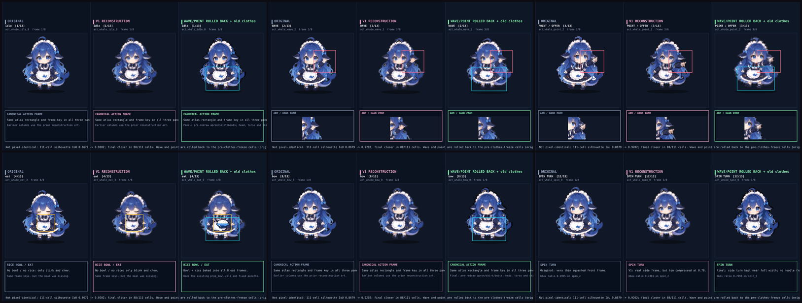
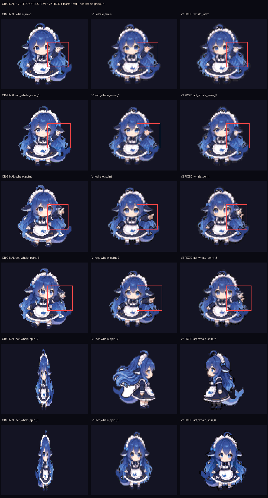
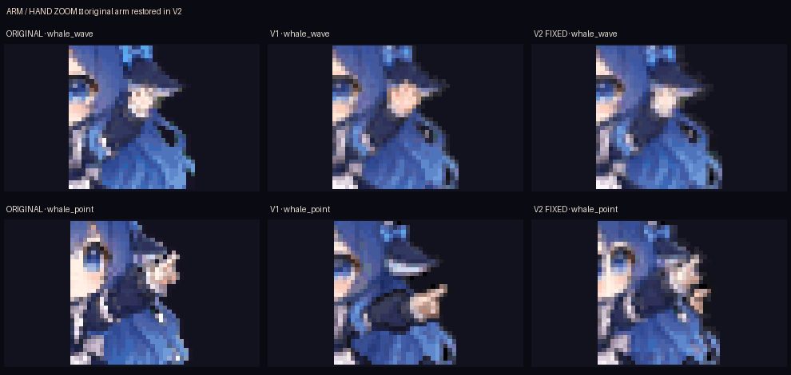

# 母版「本鲸」V2 修复与渲染对照报告（2026-11-24）

> **历史文档，仅记录 2026-11-24 的 V2 阶段，不再代表当前母版。** 当前分支 `arena/e3350838-latest-aiyunying`，HEAD `7217fde`。用户先明确选择 `full_redraw` / `all_actions` / `sync_all`，随后选择 `master_soft` / `regen_closer` / `spin_point` / `short_film`，又追加纠正「挥手手还是断的请修复」。之后又有手臂 / 饭碗 / 清晰度 / 衣服与头身联动修正；当前实际入库状态、canonical SHA256 `a6b3350a9a187648d6718c97d2bbfa14f2cf63d30c74c1ab3c4824539948c2a6` 和最终 QA 见 [`whale_redraw_report.md`](whale_redraw_report.md)。本文件里的 V2 哈希、`v2_similarity.json` 数值与短片哈希均为当时记录，不可作为当前验收依据。**没有 commit / push / PR，没有换分支；整片渲染、音频复核与人工签收仍不在授权内。**

## 直接回答：渲染后和原版一样吗？

**不是逐像素一样，也不是应该一样。** V1 是明显偏离原版的新生成重画；V2 按用户选择把旧参考格作为主参考，重画了正脸 / 眨眼 / 挥手 / 递出去 / 侧面五张基础稿，并把原版里连通的肩—袖—手区域覆盖回挥手和递出去两稿，修复断手观感。对 111 个本鲸格的机器度量见 `v2_similarity.json`：平均轮廓 IoU 从 V1 的 `0.8485` 提升到 V2 的 `0.8991`，平均 RGB MAE 从 `42.12` 降到 `39.57`；107/111 格轮廓更接近原版，88/111 格颜色更接近原版。短片对照用同一坐标表、同一帧名并排渲染原版 / V1 / V2，覆盖全部 13 个动作。







**转圈是有意不完全复刻原版**：原版 `act_whale_spin_2` / `spin_6` 是把正脸压到 `sx: 0.34` 的 26×88 细面条，正是用户说「有问题」的地方。V2 保留真实侧面转身，并把 V1 的 `0.72` / `0.78` 横向压缩放宽到 `0.88` / `0.94`；8 帧转圈最小包围盒宽高比 `0.6628`，`thinSpinAfter` 为空。挥手 / 递出去则尽量贴近原版的连臂像素，因为用户明确指出手断。

## 一眼看结果

| 项目 | 重画前基线 | V1 | 当前 V2 |
| --- | --- | --- | --- |
| 母版 `通用模板/engine/assets/cast_atlas.png` | SHA256 `5f9894b6ad38…`，1,689,618 B | `eec17bcc60c6…`，1,696,719 B | `391d0693fabc9…`，1,730,739 B |
| 图集尺寸 / 格数 | 2048×3126 / 682 | 2048×3126 / 682 | 2048×3126 / 682；`cast_atlas.json` 逐字节未变 |
| 本鲸母版格 | 111 格 | 111 格全改 | 111 格全改，`changedNonWhaleCells: 0` |
| 本鲸动作 | 13 / 92 | 13 / 92 | 13 / 92；`cast_actions.json` 逐字节未变 |
| 其他角色 | 571 格 | 0 格改动 | 0 格改动，且仍为 0 / 255 硬 alpha |
| 细面条转圈 | `spin_2` / `spin_6` 比例 `0.2955` | 无，最小 `0.5714` | 无，最小 `0.6628` |
| 挥手 / 递出去手臂 | 连通 | 视觉上断手 / 断腕 | 原版连臂区域确定性覆盖，局部见 `wave_arm_fix_zoom.png` / `point_arm_fix_zoom.png` |
| 边缘 | 硬 alpha | 硬 alpha | `master_soft`：本鲸 1px 覆盖边 alpha `184`，29,930 px；非本鲸仍硬 alpha |
| 镜像 / 资产哈希 | 9 面旧母版 | 9 面 V1 | 9 面 V2 逐字节一致；42 项 `assets.manifest.json` 已刷新 |

`cast_atlas.v1.png` 保存了上一版母版，供三列短片对照；`cast_atlas.before.png` 仍是重画前基线。`before_after_all_frames.png`、`after_all_whale_frames.png`、`before_after_selected.png` 与 `whale_redraw_qa.json` 已按 V2 刷新。

## 本轮做了什么

1. **V2 基础稿更贴近原版**：生成 `whale_{front,blink,wave,point,side}_v2_raw.png`，用 `clean_whale_raw.py` 去棋盘格底，得到 `*_v2_clean.png`。V1 原稿 / 清洗稿改名保留为 `*_v1_raw.png` / `*_v1_clean.png`。生成工具仍未暴露模型 / 版本 / seed，记为 `unknown`。
2. **断手修复**：`fix_whale_arms.py` 从旧 `whale_wave_ref.png` / `whale_point_ref.png` 按归一化坐标裁出连通的肩—袖—手区域，覆盖到 V2 清洗稿，生成 `whale_wave_v2_fixed_clean.png` / `whale_point_v2_fixed_clean.png`。这两个文件成为当前 `whale_wave_clean.png` / `whale_point_clean.png`；其余三个基础格直接用 V2 清洗稿。局部前后图在 `wave_arm_fix_zoom.png` / `point_arm_fix_zoom.png`。
3. **转圈修复**：`bake_actions.mjs` 的本鲸 `spin` 分支从 V1 的 `sx: 0.72 / 0.78` 改为 `0.88 / 0.94`，保留正面 → 微收 → 侧面 → 反面 → 侧面 → 微收 → 正面的顺序；非本鲸分支逐像素不变。
4. **量化 / 重烘**：`encode_whale_sprites.py` 仍把 5 张基础稿映射到 248 色索引调色板，透明索引 `255`，29 条精灵记录写入 `whale_sprites.json`；`apply_whale_sprites.mjs` / `apply_whale_walk.py` 重建 `sprites_data.js` / `walk_cycle_data.js`。`npm run actions` 保留 682 个原坐标，`npm run atlas` 重烘母版。
5. **稍微去除像素化**：`master_soft` 不改分辨率、不改成全局线性过滤。`tools/render_defaults.json` 新增 `visualQuality.pixelSmoothing: 0.28`；`bake_atlas.mjs` 只给 111 个本鲸格加一层调色板内、1px、alpha `184` 的覆盖边；`通用模板/engine/actors.ts` 的 `pixelMat` 只给本鲸卡片用 `0.28` 十字邻域 RGB 轻微混合，并输出边缘 alpha。`atlasFilter` 仍是 `nearest`，其他角色卡片仍为硬边。
6. **派生图 / 镜像 / 哈希同步**：`tools/split_cast.py --write` 重建 `人物/` 受管派生图；随后从 HEAD 恢复 10 个非受管文件（`人物/q版/笨鱼*`、`人物/道具/满月篇/*`），避免直接写盘误删。9 面工程镜像用当前母版字节覆盖，`npm run assets:write` / `assets:check` 刷新并通过 42 项哈希。opus 重排变体、两份月亮工程历史生成素材仍按原哈希锁定。
7. **短片对照**：`通用模板/actions_preview/film_compare/` 是 `window.__FILM__` 捕获契约的静态 dist。`tools/shoot_film_adapter.mjs` 输出 6.5 秒 / 12 fps / 78 张 PNG，`tools/encode_frames.py` 编成无声 MP4：`film_compare.mp4`（0.7 MB）与预览副本 `通用模板/actions_preview/film_compare/compare.mp4`。6 张代表帧在 `film_compare_frames/`，总览在 `film_compare_contact.png`。浏览器预览台首页内嵌短片，`/film/` 是全屏版。

## QA

`tools/check_whale_redraw.py` 已按 `master_soft` 改写：允许本鲸格出现 `0 / 184 / 255` 三档 alpha，并要求 184 的边缘像素必须四邻域接触硬边、颜色仍在 248 色表内、四角无不透明像素；任何非本鲸格出现半透明都会报错。其余检查仍是 682 格逐格字节比对、连通域、透明四角、包围盒比例、13 动作 / 92 帧索引、13 张派生图共 682 帧、9 面镜像与根清单哈希。

最终实际执行：

```text
npm run qa:all
EXIT 0
52 JS tests / 52 pass / 0 fail
Ran 13 Python tests … OK
tsc --noEmit -p tsconfig.quality.json … OK
cast_atlas.png 校验一致 2048×3126 · 682 格 · sha256 391d0693fabc9cce14a4bb9b3bbc8e8f343a9cf8ab20f80d48f641d3bfb7f977
WHALE_REDRAW_OK 111 frames · 13 actions · 92 derived frames · 9 mirrors · whale-only changes
WALK_BLEED_OK 58 walk frames · no disconnected border fragments
TACHIE_CHECK_OK 8 transparent standing-art files · single-layer
ASSET_HASH_OK 42 files · master 391d0693fabc
GENERATED_ASSET_OK 11 assets · 22 copies
GENERATED_POSTPROCESS_OK 11 outputs · 6 inputs · 番外MV/若是月亮还没来/源码
GENERATED_POSTPROCESS_OK 11 outputs · 6 inputs · 番外MV/若是月亮fable5.2high/源码
qa:visual status ok · 24 frames · meanFrameDifference 2.212 · no blank/frozen frames
```

`npm run qa:visual` 按 V2 图集重算交付链对照：PSNR `18.16 → 65.88 dB`（+47.71），边缘能量 `6.85 → 22.16`（+15.31）；`docs/quality_comparison/fix_comparison.md`、`human_sign_off.md` 与 `comparison.json` / `motion_qa.json` 已同步。唯一保留警告仍是历史生图的 `legacy_unknown`。

模板捕获链实际输出：

```text
node tools/shoot_film_adapter.mjs … SHOT_OK 78 PNG frames
ENCODE_OK docs/quality_comparison/whale_redraw/film_compare.mp4 0.7 MB
```

## 还没做 / 边界

- 没有整片从头到尾看过、听过；没有真实全片逐帧捕获、音频复核或人眼签收。`docs/quality_comparison/human_sign_off.md` 仍是 **NOT SIGNED**，新增了 6.5 秒三版短片复核项。
- 短片是三列 atlas 帧并排的确定性渲染对照，不是把旧 MV 成片重新解码出来的 A/B，也不是带音乐、镜头、3D 场景的整片；它只回答「这 13 个动作在同一渲染链下与原版是否一样」。
- V2 仍是用户授权的新生成重画，不是逐像素复刻；转圈按修复需要保留侧面转身，和原版细面条帧不同。挥手 / 递出去的连臂区域来自旧参考格，但其余像素来自 V2 重画。
- 没有提升母版分辨率；`master_soft` 只是 1px 覆盖边和本鲸卡片 shader 的轻微 RGB 混合。
- 没有改 1024×1922 的 `把回忆拼好` opus 重排图集变体；它仍是单独登记哈希的变体。
- 没有 commit / push / PR，没有改分支；工作区变更按当前会话分支自动保存。

来源、许可状态与复现顺序见 `通用模板/cast/source/whale_redraw_refs/README.md`；预览台与短片路由说明见 `通用模板/actions_preview/README.md`。
